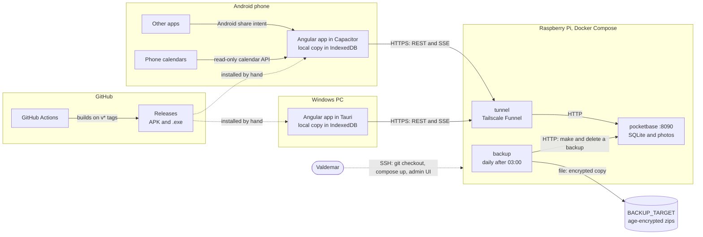

# System overview

The phone, the desktop, the Pi and GitHub, and what talks to what over which protocol.

- The build plan (decision 6) calls this online first, but the screens only ever read the local copy; the network is used by sync alone.
- The tunnel is still an open question in the build plan; the code ships Tailscale Funnel, in its own container so it can be swapped.
- Neither app updates itself, and nothing in GitHub reaches the Pi.
