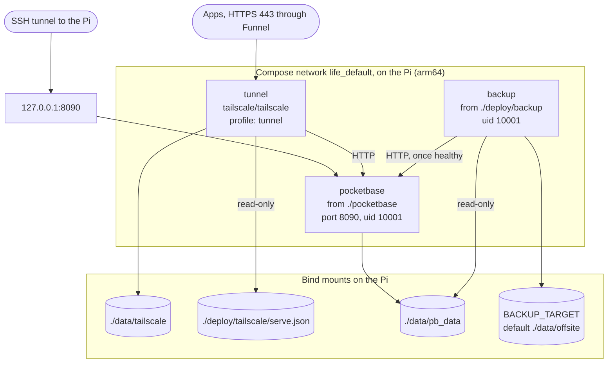

# Deployment: production

The services, volumes, network and ports in `docker-compose.yml`, on the Pi.

- `pocketbase` and `backup` have a read-only filesystem, no capabilities and `no-new-privileges`; `tunnel` has only `no-new-privileges`.
- The tunnel starts only with `--profile tunnel`, and it answers `/_` and `/api/collections/_superusers/` itself with "Not found".
- The folders are bind mounts, not named volumes, so they can be copied and restored as plain files.
