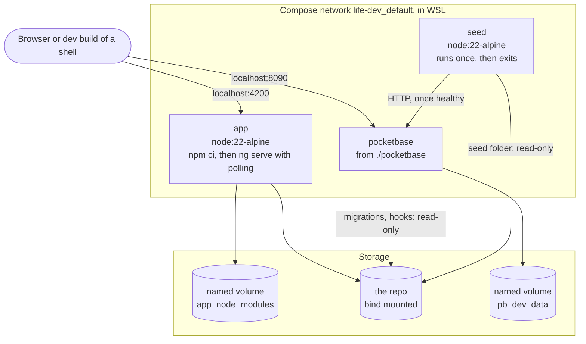

# Deployment: dev environment

The services, volumes, network and ports in `docker-compose.dev.yml`, on the development machine.

- There is no `backup` or `tunnel` here, and no hardening; the logins are fixed development values in the Compose file.
- Files on `/mnt/c` are slow to watch, so the dev server polls and the PocketBase data stays in a named volume.
