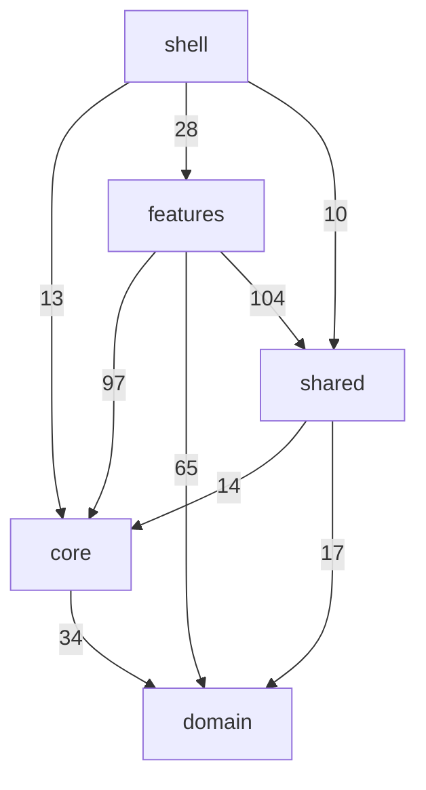

# Code layers

Which layers of the Angular app import which, with the number of imports on each arrow. Generated from the real imports by `npm run diagrams` in `app/`; don't edit by hand.

- The rules are in `app/.dependency-cruiser.cjs`, and `npm run lint` fails on a break: each layer imports only the layers below it, and a feature never imports another feature.
- Dexie and the PocketBase SDK may only be imported by `core/data`, `core/sync` and `core/server`.
- The diagrams after this one leave out `domain`, which every layer may import.
