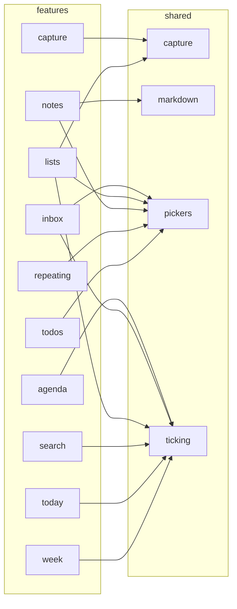

# Features to shared

Which shared UI modules each feature uses. Generated from the real imports by `npm run diagrams` in `app/`; don't edit by hand.

- Not drawn, because most features use it: `shared/ui`, used by all but `capture`, `sign-in`.
- No other arrows, so not drawn: `archive`, `settings`, `setup`, `sign-in`.
