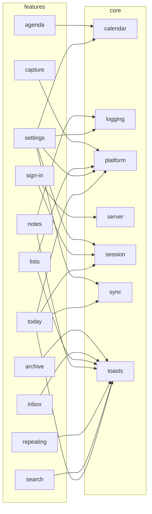

# Features to core

Which core services each feature uses. Generated from the real imports by `npm run diagrams` in `app/`; don't edit by hand.

- Not drawn, because most features use it: `core/data`, used by all but `capture`, `sign-in`.
- Not drawn, because most features use it: `core/time`, used by all but `capture`, `setup`, `sign-in`.
- No other arrows, so not drawn: `setup`, `todos`, `week`.
