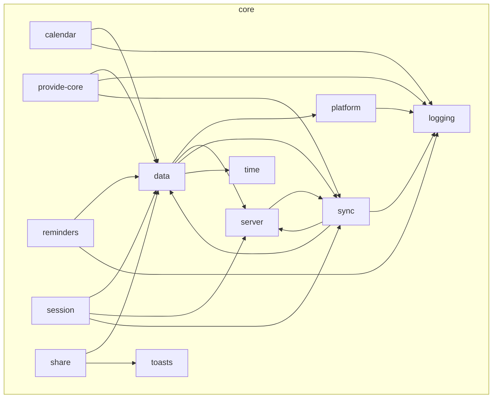

# Inside core

How the modules inside `core` import each other. Generated from the real imports by `npm run diagrams` in `app/`; don't edit by hand.

- The arrows both ways between `data`, `sync` and `server` are between folders. No file-level import cycle exists, and `npm run lint` fails if one appears.
