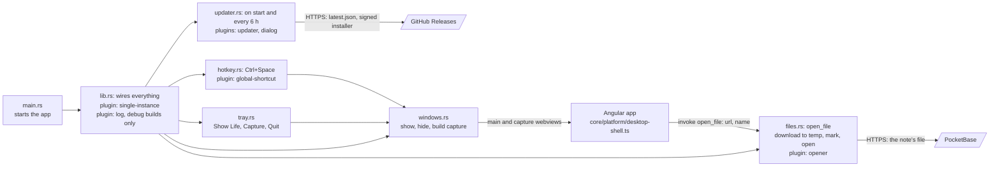

# Tauri modules

The Rust modules of the desktop shell in `desktop/src-tauri/src/`, the plugins they use, and where they meet the Angular app.

- IPC is two calls, each granted to one window: the capture window may hide itself (`capabilities/default.json`), and the main window may call `open_file` (`capabilities/open-files.json`, generated as `allow-open-file` from `build.rs`). `error.rs` holds `AppError`, used by `lib`, `hotkey` and `tray`.
- Closing a window hides it; only Tray › Quit ends the app.
- `updater.rs` runs in release builds only. It reads `latest.json` from the newest GitHub release, asks in a native dialog, and on "Install and restart" checks the installer against the public key in `tauri.conf.json`, runs it passively and restarts. All of it is in Rust, with no IPC.
- `files.rs` downloads a note's file to `%TEMP%\life-files\<time>\<name>` (folders older than a day are cleared), marks it as downloaded from the internet and opens it with the default app. The opened file is a copy; editing it doesn't change the note.
