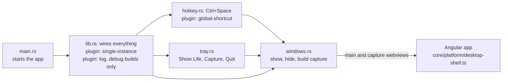

# Tauri modules

The Rust modules of the desktop shell in `desktop/src-tauri/src/`, the plugins they use, and where they meet the Angular app.

- There are no custom commands: the only IPC is the capture window hiding itself (`capabilities/default.json`). `error.rs` holds `AppError`, used by `lib`, `hotkey` and `tray`.
- Closing a window hides it; only Tray › Quit ends the app.
