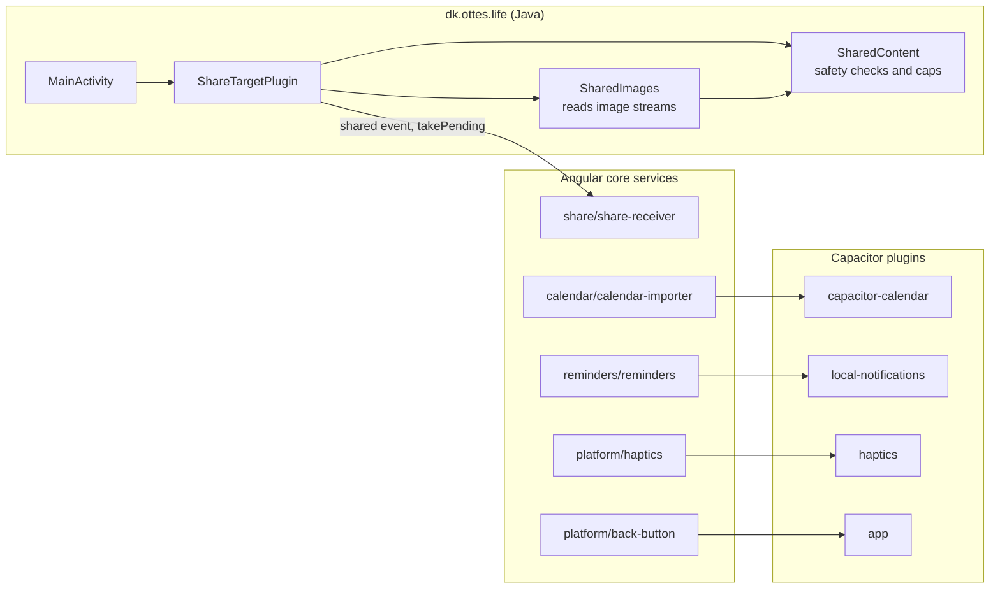

# Android native parts

The Java classes and Capacitor plugins of the Android shell in `app/android/`, and the Angular services that use them.

- Android asks for `READ_CALENDAR` and `POST_NOTIFICATIONS`, both when first needed.
- `SharedImages` reads the images, but the app only counts them for the note's title: see [Capture](08-capture.md).
