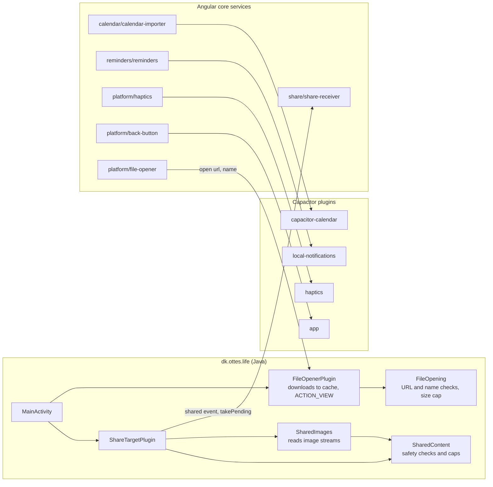

# Android native parts

The Java classes and Capacitor plugins of the Android shell in `app/android/`, and the Angular services that use them.

- Android asks for `READ_CALENDAR` and `POST_NOTIFICATIONS`, both when first needed.
- `SharedImages` reads the images, but the app only counts them for the note's title: see [Capture](08-capture.md).
- `FileOpenerPlugin` downloads a note's file into `cache/opened/` (folders older than a day are cleared), then hands it to another app through the FileProvider. It only downloads over HTTPS, or HTTP from `localhost`, `127.0.0.1` and the emulator's `10.0.2.2`.
