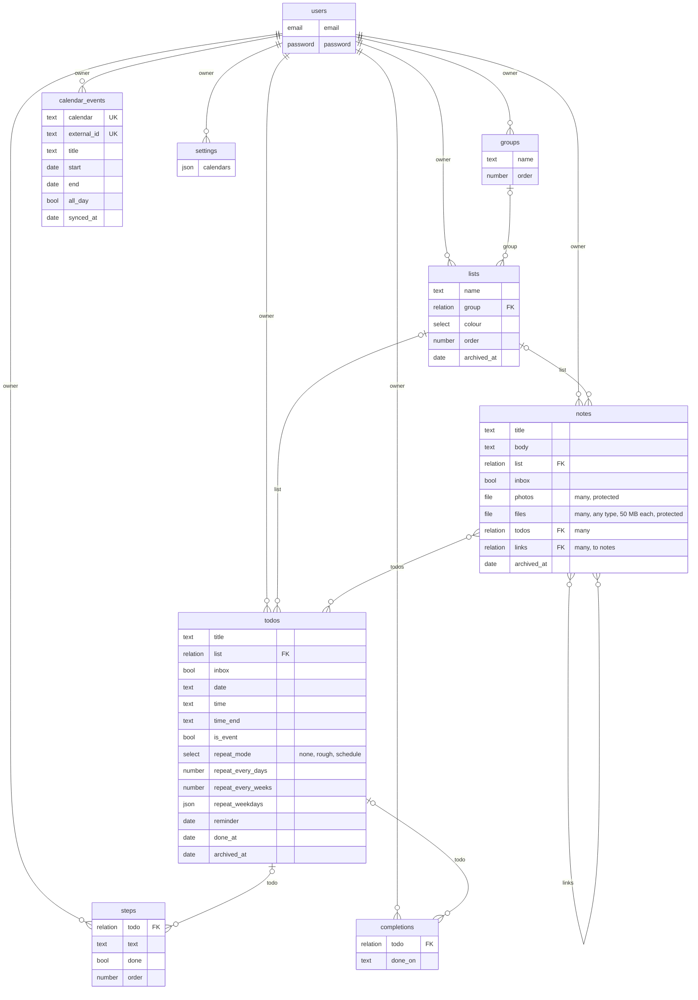

# Data model

Every PocketBase collection, its main fields and its relations, taken from `pocketbase/pb_migrations/`.

- The eight synced collections also have `id` (made on the device), `owner` (set by the server), `changed_at`, `deleted_at`, `created` and `updated`.
- `changed_at` isn't in the build plan's data model: the device's time of its last change. Lists sort by it, and a device uses it to recognise its own write coming back. Conflicts go by arrival at the server instead: see [conflicts](05b-sync-conflict.md).
- No relation is required or cascades, so an empty `list` means the Inbox or no list; `calendar_events` and `settings` relate to nothing else.
