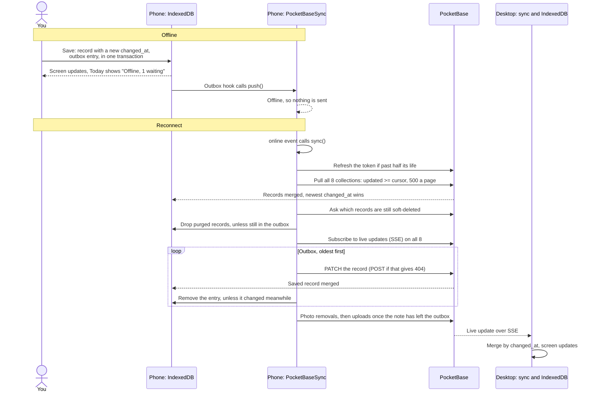

# Sync: an offline change

A change made offline on the phone: queued in the outbox, sent on reconnect, and arriving on the desktop through live updates.

- Status 0, 429 or 5xx counts as offline and retries in 30 seconds; 401 or 403 [ends the session](06b-expired-token.md); any other refusal drops that outbox entry and logs it.
- A device that missed the live update catches up on its next pull, at start, on reconnect or with Settings › Sync now.
- Offline and sync 1 in the build plan says SQLite on Android; decision 16 and the code use IndexedDB (Dexie) everywhere.
