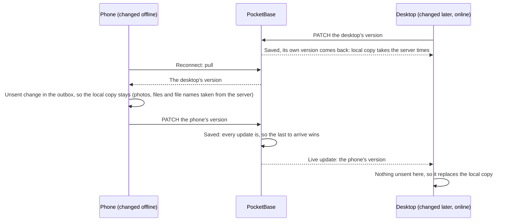

# Sync: conflicts

What happens when both devices changed the same record: the change that reaches the server last wins the whole record, with no prompt (Offline and sync 4). The device's clock doesn't matter.

- A device keeps its local copy over the server's only while it has an unsent change to that record: that change reaches the server later, so it will win there too.
- A record coming back with the device's own `changed_at` is its own write echoed; it replaces the local copy and brings `created` and `updated`.
- If the record changes again while it's being sent, the outbox keeps the entry (its `changed_at` moved on) and sends it once more.
- The whole record wins; fields are not merged. Photos and files are the exception: they only ever come from the server.
- The build plan's open question stands: the SyncConflict screen isn't built.
