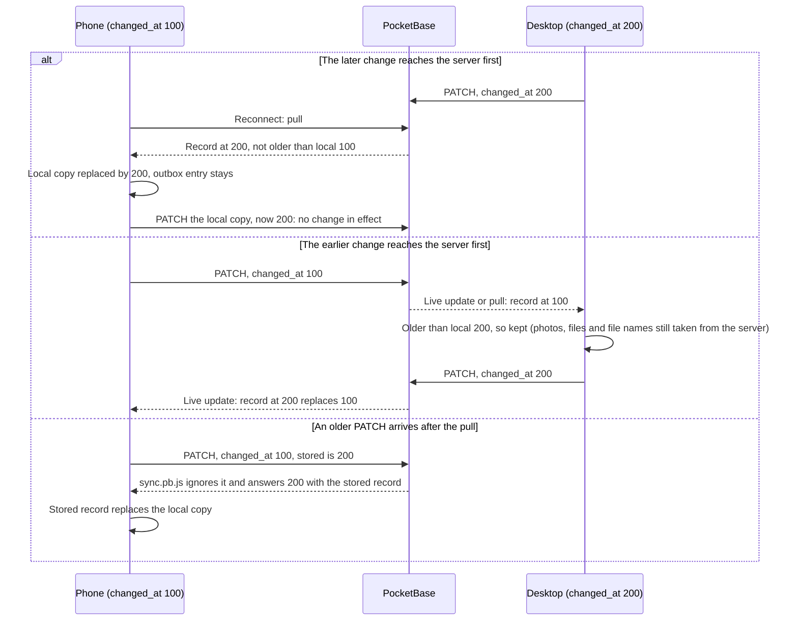

# Sync: conflicts

What happens when both devices changed the same record while offline: the later `changed_at` wins the whole record, with no prompt.

- The build plan (Offline and sync 4) says the later `updated` wins. The code uses `changed_at`, set by the device's clock, so a wrong clock can lose or win a conflict.
- The whole record wins; fields are not merged. Photos are the exception: they only ever come from the server.
- The build plan's open question stands: the SyncConflict screen isn't built.
