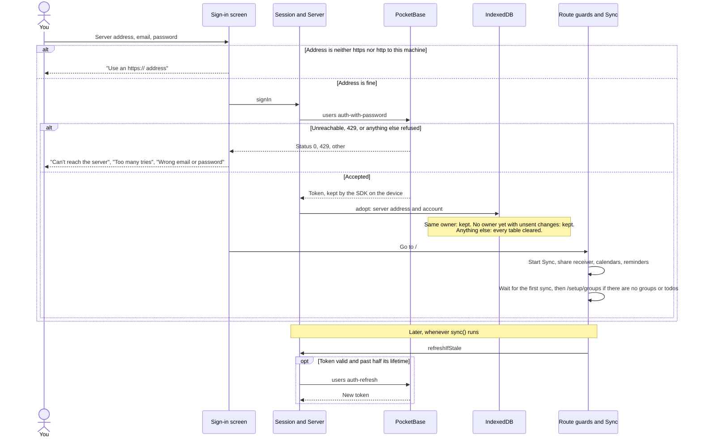

# Sign-in: logging in and token refresh

Logging in from the sign-in screen, what starts afterwards, and when the token is refreshed.

- `sync()` runs at app start, on the `online` event, on the 30-second retry and on Settings › Sync now. It has no timer, so an app that stays open and online doesn't refresh.
- PocketBase allows 5 sign-ins a minute per client, and refuses superusers that come through the tunnel.
