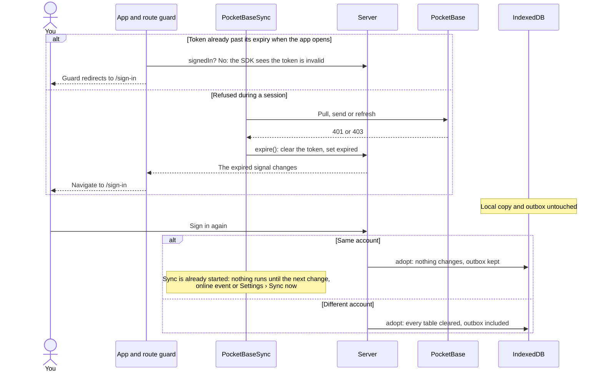

# Sign-in: an expired token

How the app gets back to sign-in when the token has expired, and what happens to unsent changes.

- Sign-out is different: Settings › Sign out stops sync, clears the token and deletes the whole local database, then reloads at `/sign-in`.
