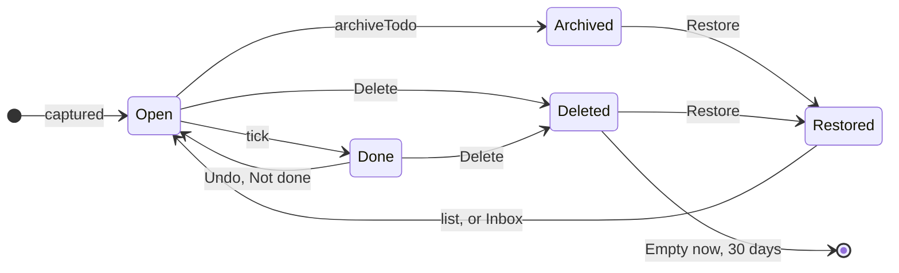

# Lifecycle: a todo

The life of a one-off todo, from `done_at`, `archived_at` and `deleted_at`. [Open](07b-todo-open-states.md) has states of its own.

- `archiveTodo` in `core/data/actions.ts` is the only thing that sets `archived_at` on a todo and no screen calls it, so Archived is reachable in code only. The Archive screen still lists and restores such todos.
- Restoring returns a todo to its list, or to the Inbox if the list was deleted. A record isn't kept after 30 days: the app stops showing it and the server purges it at 04:15.
- A restored done todo stays done, because only `archived_at` or `deleted_at` is cleared.
