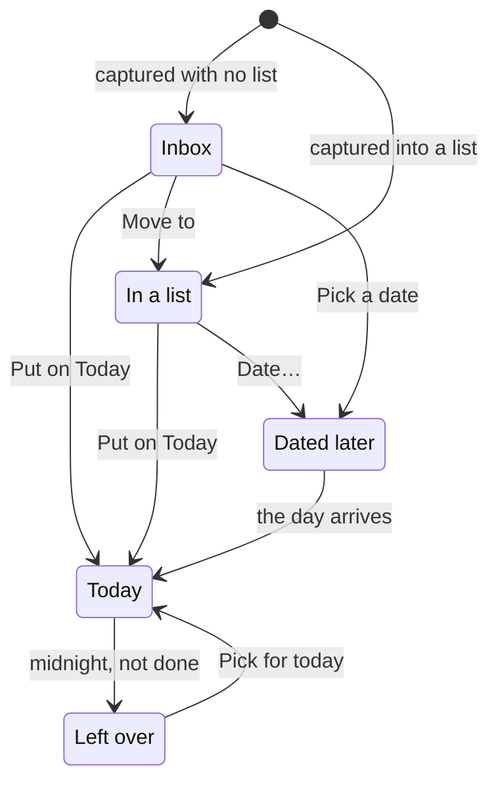

# Lifecycle: an open todo

Where a todo that isn't done sits. None of this is stored as a status: it comes from `inbox`, `list` and `date`.

- A todo captured with a date and no list keeps `inbox` on, so it's in the Inbox and on Today at once until it's moved.
- An event (`is_event`) has no tick box and never becomes left over.
