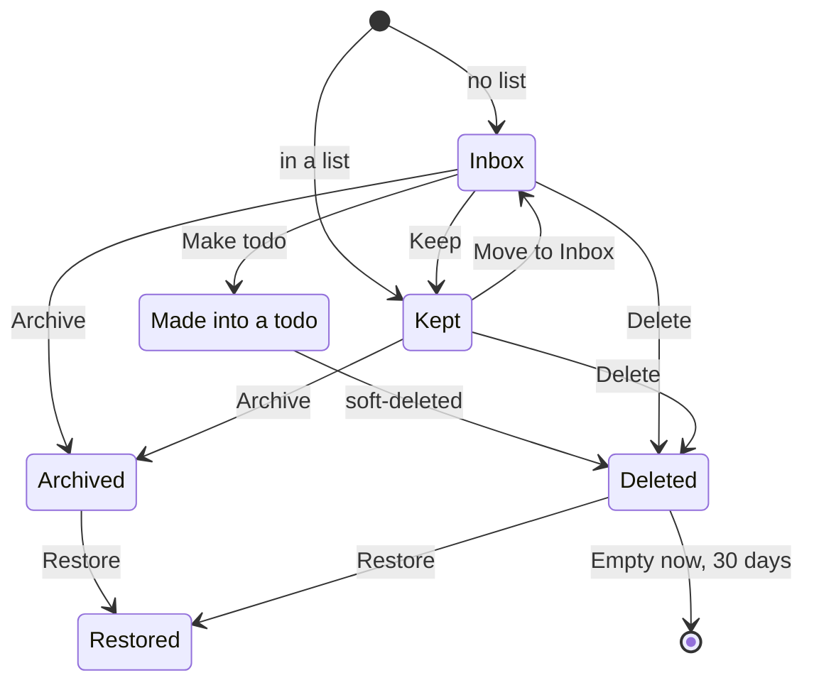

# Lifecycle: a quick note

The states of a note, from `inbox`, `archived_at` and `deleted_at`; a quick note is simply a note with `inbox` on.

- Make todo takes the note's list and Inbox flag and uses its title, or its first line, as the title. The body, photos and files stay behind on the deleted note, which then sits in Recently deleted; Undo reverses both.
- Restored goes back to the Inbox if `inbox` is still on or its list was deleted, and otherwise to Kept. Keep is also a swipe right, Archive a swipe left, and Move to a list leaves the Inbox too.
- Add note on a todo starts a note as Kept, even with no list. Make todo is offered only on an Inbox note.
