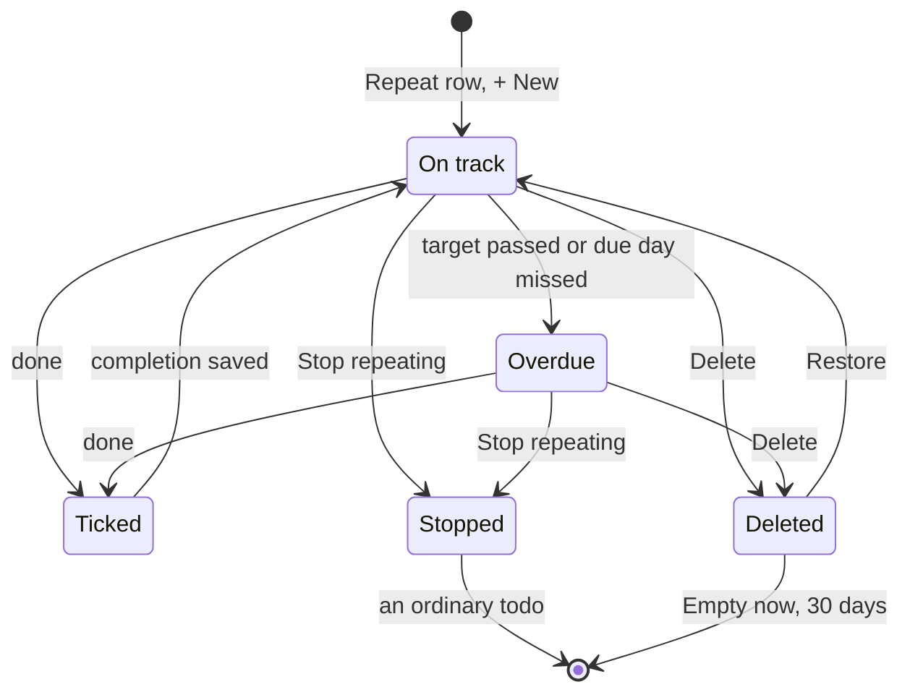

# Lifecycle: a repeating item

The states of a repeating item. On track and overdue aren't stored: `repeatStatus` works them out from the `completions` each time.

- "Just count days" has a target of 0, so it never becomes overdue.
- Done means today or yesterday; marking a day twice keeps one completion, and Undo removes it. Stopping keeps the completions, and sets the list and date picked there.
- Overdue means a rough item's days since passed the target, or a scheduled item's due day went by undone.
