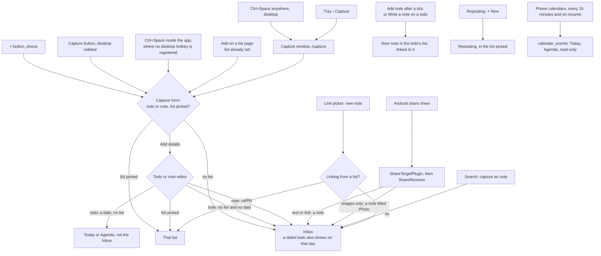

# Capture

Every way something gets into the app, and where each one lands.

- R3 says shared photos become a quick note, but `ShareReceiver` only counts the images for the title: the note has no photos.
- The form and the editor differ on a dated todo with no list: the form keeps `inbox` on, the editor turns it off.
- The home-screen widget in R1 is planned for version 2, and doesn't exist.
