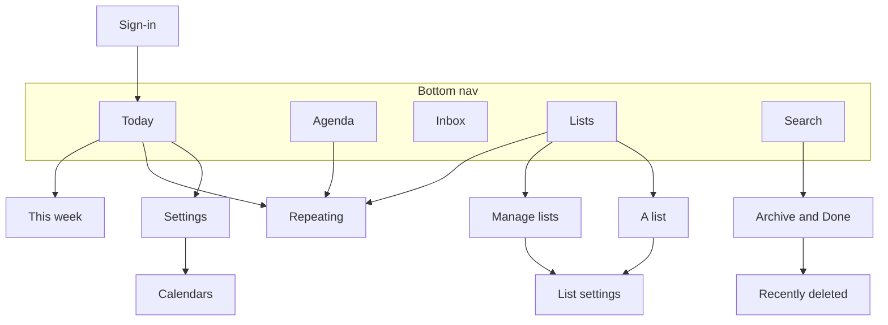

# Screen map: phone

The screens under 900px wide and how you move between them; [the detail screens](09b-screens-details.md) are a diagram of their own.

- With no groups and no todos, Today first sends you through Setup: groups, then Setup: lists. This week links to Inbox, and Settings also links to Manage lists, Archive, Recently deleted and Error log and has Sign out; those arrows are left out to keep the map readable.
- Sheets aren't screens: Capture opens from the + button, and Pick for today from Today.
- An expired login sends any screen to Sign-in. The bottom nav also shows on This week, a list, Archive and Recently deleted. It's hidden on Settings, Calendars, Manage lists, List settings, Repeating and the detail screens.
