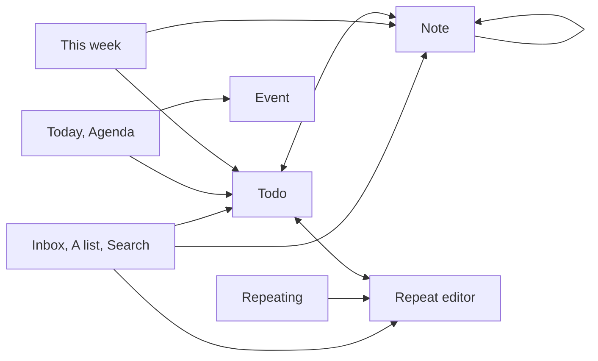

# Screen map: detail screens

Which screens open a todo, note, event or repeat editor, on phone and desktop.

- Add note on the tick toast also opens a Note from any screen that ticks.
- Going back returns to the screen you came from, which the app passes along as `state.back`.
- On desktop a plain click on a link to a Todo, Note or Event opens it in the pane beside the content; a Repeat editor always takes over the content.
