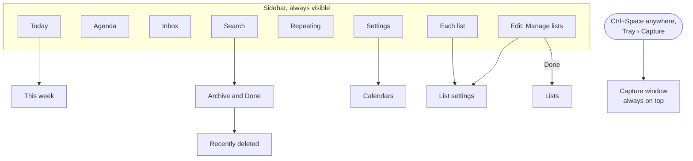

# Screen map: desktop

The screens from 900px wide: the routes are the [phone's](09a-screens-phone.md), but the sidebar replaces the bottom nav, and a separate window handles capture.

- Rows open in a detail pane beside the content: see [detail screens](09b-screens-details.md).
- The sidebar has no Lists entry: `/lists` is reached only from Manage lists and List settings. Settings also links to Manage lists, Archive and Recently deleted, as on the phone.
- Ctrl+K opens Search and `?` opens the keyboard shortcuts, from any screen in the main window.
