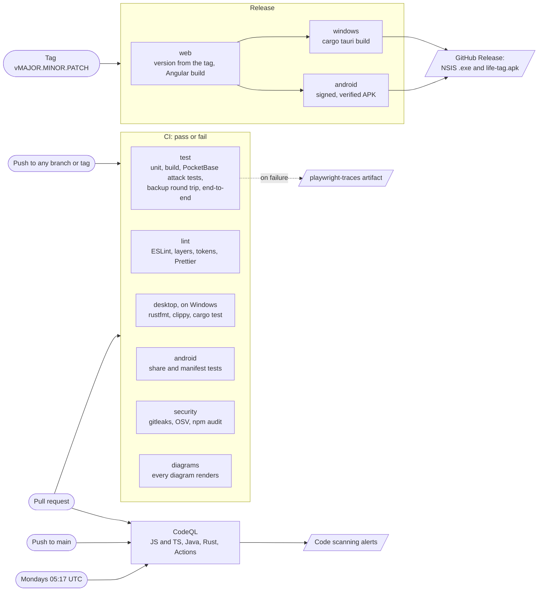

# CI/CD

What runs on a push, on a pull request, on a tag and on a schedule, and what each produces.

- A push to a tag runs CI too, because CI's `push` has no filter. Release doesn't wait for it.
- Only a `vMAJOR.MINOR.PATCH` tag starts a release; MINOR and PATCH stay under 100. The version goes into the web build (Settings › Version), the APK's `versionName` and `versionCode`, and the desktop installer. A release fails if the Android signing secrets are missing.
- Nothing deploys to the Pi. Dependabot opens weekly pull requests for npm, Cargo, Gradle, Docker and Actions.
